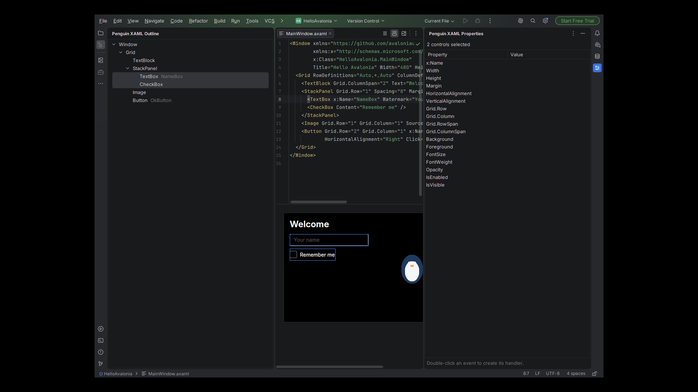

# Penguin XAML

A drag-and-drop XAML designer for [Avalonia](https://avaloniaui.net) apps in JetBrains Rider on Linux, modelled on
the classic WPF designer: XAML for the look, C# code-behind, and a design view kept in sync with the XAML.

## Requirements

- JetBrains Rider 2026.1 or newer, on Linux
- The .NET 10 runtime (`sudo apt install dotnet-runtime-10.0`, or Microsoft's installer)

## Install

Download the plugin zip from the latest CI run (Actions → CI → `penguin-xaml-plugin`; unzip the download once to get
`penguin-xaml-<version>.zip`), then in Rider: Settings → Plugins → gear icon → Install Plugin from Disk.

## Quick start

1. Open an Avalonia project (or `samples/HelloAvalonia` or `samples/ChessBoard` from this repository), or start one with
   File → New → Avalonia App (Penguin XAML).
2. Open `MainWindow.axaml`. The window is drawn above its XAML.
3. Open the **Penguin XAML Toolbox** and drag a Button onto the window. The label shows where it will land.
4. Select, move, resize or delete controls; Ctrl+Z undoes each change. Arrow keys nudge, Ctrl+C / Ctrl+V / Ctrl+D
   copy, paste and duplicate, Ctrl+mouse wheel zooms. Drag on an empty area to select several controls.
5. Select a Grid and click the strip above or beside it to add a column or row; drag the dashed lines to resize.
6. Double-click a button to write its Click handler in `MainWindow.axaml.cs`.

Bindings show real values when the window has a `<Design.DataContext>` and the project has been built.

## Credits

Built on [Avalonia](https://github.com/AvaloniaUI/Avalonia) (MIT), drawn with SkiaSharp and HarfBuzzSharp (MIT).
See [THIRD-PARTY-NOTICES.md](THIRD-PARTY-NOTICES.md). Penguin XAML is MIT-licensed.
